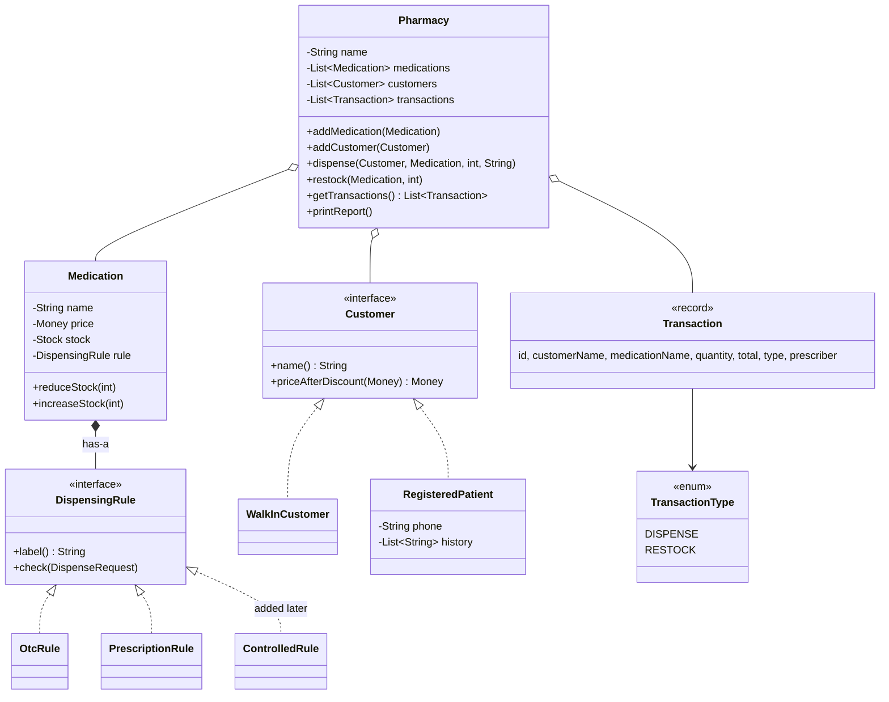
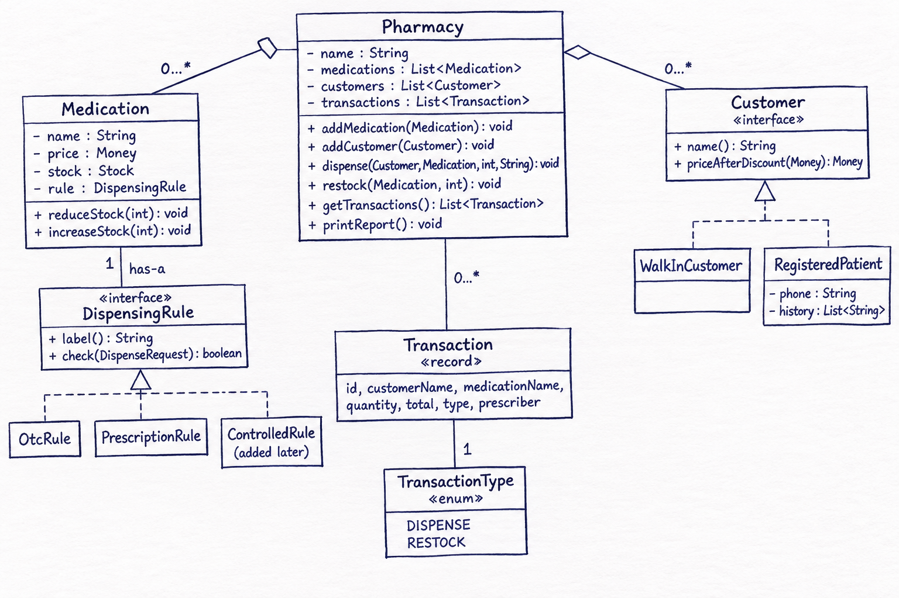

# DIAGNOSIS: Akosua's Pharmacy Tracker

> Written and committed **before any code change**. The design may change as I build; any change is explained in the README ("Design changes from DIAGNOSIS.md").

## 1. Summary

The starter program tracks medicine stock and dispensing for a community pharmacy. It compiles and runs, but its design lets the most important number in the business, the stock count, become invalid. Running the original shows this: after the final dispense in `main`, **Amoxicillin 250mg is at -61 in stock** (40 - 1 - 100). Everything below is ranked by how much it threatens the correctness of the pharmacy's numbers and records, then by how much it blocks the planned controlled-substances change.

## 2. Most dangerous problem for this business

**Unprotected stock count.** `Medication.stock` is a `public int`, and `Pharmacy.dispense` subtracts from it with no checks.

- **Root cause:** the object that owns the number (`Medication`) does not protect it. Any code anywhere can write to the field, and the one method that normally changes it never asks "is there enough?". The rule "stock is never negative" is written nowhere.
- **Business risk:** a pharmacy dispenses a physical, regulated product. A wrong count means the team believes they hold medicine they do not (a patient is told yes, then turned away, or a wrong dose is substituted), reordering decisions are wrong, and every other number in the report becomes untrustworthy. It fails **silently**: nothing crashes and nothing warns. Akosua already stopped trusting the program for exactly this reason.
- **Evidence:** the baseline output (`baseline-output.txt`) shows -61 for Amoxicillin.

This is the most dangerous defect because it corrupts the data the business runs on, silently, and it is the one rule the brief says must never be broken.

## 3. Ranked defects

### Tier 1: correctness of the numbers

| # | Defect | Root cause | Business risk | Planned fix |
|---|---|---|---|---|
| 1 | Stock can go negative (`m.stock = m.stock - qty`) | No check in `dispense`; `stock` is public | Wrong counts | `Medication` owns a private stock value; only `reduce` and `increase` change it, and they reject invalid changes with an exception |
| 2 | All fields public on `Medication`, `Customer`, `Pharmacy`; `main` sets `ama.phone` directly | No encapsulation | Any future edit anywhere can break any value; changing a field name breaks the whole file | Private fields, behaviour through methods, no setters |
| 3 | No quantity validation: `dispense(..., -5, ...)` *adds* stock and gives a negative total; restock has the same hole | Quantity is never checked | Stock goes wrong by a "valid-looking" operation; negative totals corrupt money reports | Reject quantity <= 0 in dispense and restock |
| 4 | Constructors accept nonsense (negative stock, negative price, blank name) | No validation at creation | The invariant can break at birth | Validate in constructors |

### Tier 2: trustworthiness of the records

| # | Defect | Root cause | Business risk | Planned fix |
|---|---|---|---|---|
| 5 | `getTransactions()` returns the live internal list | Returning a reference, not a safe view (aliasing: caller and `Pharmacy` share one heap object) | Any caller can `clear()` or edit the audit trail | Return an unmodifiable view or a copy |
| 6 | Unknown category still writes customer history and a DISPENSE transaction | The `if / else if` has no `else`; the recording lines run after it regardless | **Phantom records**: a sale is logged that never happened | Unknown categories become impossible by construction (no free strings) |
| 7 | The prescriber is printed but not stored in `Transaction` | `Transaction` has no prescriber field | Missing evidence of who prescribed what; the controlled-substances rule needs this | Store the prescriber on the transaction |
| 8 | Blank prescriber (`""`) passes; only `null` is checked | Weak validation | A prescription is "satisfied" without a real prescriber | Reject null and blank |
| 9 | Failed dispenses are silent to the caller (prints and returns) | Business logic is welded to console output | The caller cannot tell a sale failed; hard to test | Reject with an explicit exception, and let `Pharmacy` report the message |
| 10 | Transactions store names, not references | Strings used as identity | Two medicines with the same name become ambiguous | Keep medicine identity in the transaction |

### Tier 3: ability to grow safely (blocks the controlled-substances change)

| # | Defect | Root cause | Business risk | Planned fix |
|---|---|---|---|---|
| 11 | `dispense` is a "god method": validates, prices, discounts, updates stock, writes history, records the transaction and prints | No separation of responsibilities | A change to one job risks the others, which is how the team got "burned before" | Small methods, each with one job; rules and discounts behind interfaces |
| 12 | OTC and PRESCRIPTION branches duplicate pricing, the 5% discount, stock subtraction and printing; only the prescriber check differs | The varying rule is mixed into the fixed flow | A third branch means a third copy of the same lines | Fixed flow in `Pharmacy`; the varying rule lives behind a `DispensingRule` interface |
| 13 | Category and customer kind are free `String`s (`"OTC"`, `"REGISTERED"`) | Strings are not checked by the compiler | `"Prescription"` compiles and silently does nothing (see #6) | Types instead of strings (see design) |
| 14 | `if (kind.equals("REGISTERED"))` discount logic is repeated and `0.95` is a magic number | No single source of truth | Changing the discount means finding every copy | One discount policy per customer type |

**What the old design forces me to touch for controlled substances:** the `if / else if` chain in `Pharmacy.dispense` (add a third branch and copy pricing, discount, stock and print lines a third time), every place that compares the category string, and the transaction/printing code to add the prescriber. All of that is inside already-working code, which is how past changes broke other categories.

### Tier 4: data model and money

| # | Defect | Root cause | Business risk | Planned fix |
|---|---|---|---|---|
| 15 | Money is `double` | Binary floating point cannot represent many decimals exactly | Small errors accumulate over thousands of sales; totals will not reconcile | A `Money` value type backed by `BigDecimal`, formatted to match the original output |
| 16 | Walk-ins carry a `phone` and a `history` list | One `Customer` class for two different shapes | Meaningless empty fields; the original also logs history for walk-ins, which contradicts the business story | Separate customer types; only registered patients have phone and history |
| 17 | Mutable `static int counter` in three classes; ids are public and writable | Global shared mutable state | Ids can be reset or duplicated by any code | Ids assigned by one owner and immutable |
| 18 | Medicines and customers can be added twice; any medicine object can be dispensed even if never added | No registration checks | Duplicate or untracked stock | Reject duplicates; dispense only registered items |

### Tier 5: readability

Single-letter names (`p`, `m`, `c`), abbreviations (`qty`, `meds`, `kind`), everything in one file, no packages, no tests, `main` doing demo work, and the default `Transaction@42a57993` print format. These matter for the next person who inherits the code, but they do not endanger the data.

## 4. Invariants I will enforce

| # | Always true | Owner |
|---|---|---|
| I1 | A medicine's stock is never negative | `Medication` |
| I2 | A medicine's price is never negative | `Medication` |
| I3 | A medicine's name is never null or blank | `Medication` |
| I4 | Category and customer type are always valid; there is no unknown category | the types themselves |
| I5 | The transaction history only grows, through the pharmacy's own operations | `Pharmacy` |
| I6 | Every transaction is immutable and has a positive quantity | `Transaction` (record) |
| I7 | Ids are unique and never change | whoever creates the object |
| I8 | A walk-in customer has no phone number | customer types |
| I9 | Every recorded dispense actually happened | `Pharmacy` |
| I10 | Reported stock = starting stock + restocks - dispenses | design goal, checked by a test |

**Preconditions** (must be true before an action): dispense needs quantity > 0 and stock >= quantity; restock needs quantity > 0; prescription (and later controlled) dispenses need a non-blank prescriber; the medicine and customer must be registered with the pharmacy.

**Business rules** (policy, not "truth"): registered patients get 5% off; total = price x quantity, then discount; restock transactions use "(supplier)" with total 0.

## 5. Planned structure

Two things vary independently: **the rule for each kind of medicine** and **the discount for each kind of customer**. Everything else (the order of steps in a dispense) stays fixed.

**Hand sketch of the planned structure:** 

Responsibilities:

- **`Pharmacy`**: owns the fixed dispense flow (validate, price, reduce stock, record) and the audit trail. It never asks "what category is this?".
- **`Medication`**: owns its stock; exposes only `reduceStock` / `increaseStock`, which refuse invalid changes. It *has a* `DispensingRule`.
- **`DispensingRule`** (interface): the one question every category answers: *"given this dispense request, is it acceptable?"* OTC always yes; prescription needs a non-blank prescriber; controlled needs one that is also recorded. It also supplies the label used in the report.
- **`Customer`** (interface): the one question every customer answers: *"what is the price after your discount?"* Walk-in returns it unchanged; registered patients apply 5% off.
- **`Transaction`** (record): an immutable historical fact, including the prescriber.
- **`TransactionType`** (enum): a genuinely fixed set (DISPENSE, RESTOCK) with no behaviour.

## 6. Key design decisions (chose / rejected / why)

1. **What each rule answers.** The medicine rule answers "is this dispense acceptable, and what must be recorded?" The customer discount answers "what is the price after any discount for you?"
2. **Composition, not subclasses, for medicines.** Paracetamol and Amoxicillin have the same shape; only the rule differs, so only the rule should vary. A subclass per category tempts a chain (Controlled extends Prescription extends Medication), where a change in the middle ripples down, and uses up Java's single parent slot. Trade-off acknowledged: subclasses would be acceptable for three categories; composition wins when categories keep multiplying.
3. **Interface only, not enum holding rule objects.** Each rule is its own class, and the rule exposes its own label for the report. Adding a category is one new file and no edits to existing rule code. Cost: the set of categories is no longer visible in one list. I rejected an enum + `switch` outright, since it is the original problem in new clothes; I rejected an abstract class because the rules share no state. Enums are kept only for fixed sets with no behaviour (`TransactionType`).
4. **Plain interface, not sealed, for customers.** Walk-in and registered patients differ in shape (only registered has phone and history), so they are separate types. I chose a plain interface because new customer types (for example insurance or senior discounts) are plausible, and sealed would force editing the permits list. Trade-off: sealed would give compiler checking of every case; I gave that up for openness.
5. **Exception to refuse invalid changes.** A rejected operation must not be ignorable. An exception cannot be forgotten, whereas a returned result can be. `Pharmacy.dispense` catches the rejection, prints a message, and records nothing, so no phantom transaction is created.
6. **Records only for immutable facts.** `Transaction` is a record. `Medication` is not, because its stock changes over time.

## 7. Behaviour decisions I will record

- **Deliberate behaviour change (the fix):** the 100-unit Amoxicillin dispense is now rejected instead of driving stock to -61. This is the only difference from the baseline output. Everything else must match line for line.
- **Walk-in history:** the original adds history entries for walk-ins, but nothing ever reads or prints them. I will not keep a history list for walk-ins, because the business keeps history only for registered patients, and I will record this as a decision rather than a regression.
- **Money formatting:** the original prints values such as `25.0` and `28.5`. `BigDecimal` would print differently by default, so the `Money` type's formatting must reproduce the original text. The diff against the baseline is the check.
- **Unknown categories:** cannot exist in the new design, so this bug disappears by construction.
- **Prescriber-missing message:** the "Cannot dispense X without a prescriber" text stays the same.
